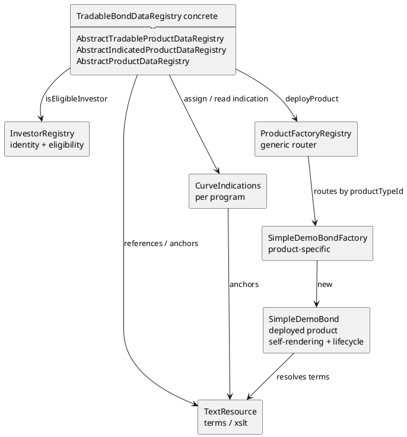

# On-Chain Tokenized Product Framework

A modular Solidity framework for issuing, referencing, and trading tokenized
financial products (e.g. bonds) with **on-chain, self-rendering terms**.

Product terms (XML) and stylesheets (XSLT) are stored immutably on-chain and
referenced by reusable *programs*. Investors request trades against a program;
each trade deploys a concrete *product* instance that resolves its own live
state into a renderable document via an ERC-8100 / `evmstate` binding profile.

---

## Table of Contents

- [Design Principles](#design-principles)
- [Architecture Overview](#architecture-overview)
- [Modules](#modules)
    - [1. Text Resources](#1-text-resources)
    - [2. Investor Registry](#2-investor-registry)
    - [3. Program Data Registry (3 layers)](#3-program-data-registry-3-layers)
    - [4. Product Indications](#4-product-indications)
    - [5. Product Factories](#5-product-factories)
    - [6. Products](#6-products)
- [End-to-End Flow](#end-to-end-flow)
- [Key Conventions](#key-conventions)
- [Deployment Order](#deployment-order)
- [Dependencies](#dependencies)
- [Status](#status)

---

## Design Principles

- **Separation of structure and state.** Terms/stylesheets are stored once as
  immutable text; concrete products resolve the dynamic `evmstate:call`
  bindings at render time. Nothing large is duplicated per trade.
- **Reusability via programs.** A *program* is a published product definition
  (terms + stylesheet + product type) under which many products are deployed.
- **Integrity by construction.** Content is anchored by `keccak256`, verified
  on-chain at finalization, and reproducible off-chain.
- **Layered abstraction.** Each concern is an `abstract` base with a single,
  deployable concrete specialization. `abstract` is used only where a genuine
  extension hook exists.
- **Consistent ownership.** All long-lived, owner-managed contracts use
  OpenZeppelin `Ownable2Step`.

---

## Architecture Overview

---

## Modules

### 1. Text Resources

Immutable on-chain storage for large text (XML terms, XSLT stylesheets), stored
as SSTORE2-chunked bytecode.

| Contract | Role                                                 |
|---|------------------------------------------------------|
| `ITextResource` | Read/lifecycle interface (ERC-165).                  |
| `TextResource` | Chunked storage, hash verification, reconstruction. One-shot **or** staged publishing. |

- **One-shot:** full content in the constructor (small resources, ≤ EIP-3860
  init-code limit).
- **Staged:** `appendChunk` across transactions, then
  `finalize` (large resources).
- **Integrity:** `contentHash() == keccak256(content())`, verified on-chain at
  finalization and reproducible off-chain
  (`keccak256(fetchedBytes) === contentHash()`).
- Chunk size bounded by `MAX_CHUNK_SIZE = 20_000` (< SSTORE2's 24 KB limit).
- Uses `mcopy` (EIP-5656) — **requires Cancun EVM**.

### 2. Investor Registry

Source of truth for investor identity, lifecycle, and eligibility.

| Contract | Role |
|---|---|
| `IInvestorRegistry` | Interface. |
| `InvestorRegistry` | Deployable (`Ownable2Step`). |

- Lifecycle: `Unknown → Active → {Suspended, Revoked}`; `Revoked` is terminal.
- **Registered** = known to the system (`status != Unknown`).
- **Eligible** = `Active` + derived per-program rules (Option B / derived model;
  `programId` reserved for future per-program criteria).

### 3. Program Data Registry (3 layers)

A *program* anchors reusable product terms and manages their lifecycle. Built as
three abstract layers plus one concrete bond specialization.

| Layer | Contract | Adds |
|---|---|---|
| 1 | `AbstractProductDataRegistry` | Program publication, lifecycle, ERC-8100 XML rendering, resource validation. |
| 2 | `AbstractIndicatedProductDataRegistry` | One replaceable *indication* per program. |
| 3 | `AbstractTradableProductDataRegistry` | Eligibility-gated trade requests + product deployment. |
| — | `TradableBondDataRegistry` | Concrete: bond resource/indication acceptance rules. |

- `programId = keccak256(abi.encode(programName, address(this)))` (name is the
  unique key; no duplicates, no renaming).
- `partId = uint256(programId)` (ERC-8100 rendering).
- Program lifecycle: `Active → {Suspended, Closed} → Archived` (terminal).
- Resources are validated at publish time: must be `ITextResource` (ERC-165),
  finalized, and of an accepted `resourceType` per slot.

### 4. Product Indications

Registries publishing price indications (e.g. yield curves) referenced by
programs.

| Contract | Role |
|---|---|
| `IProductIndications` | Generic, product-agnostic interface. |
| `AbstractProductIndications` | Indication lifecycle, id/partId, rendering dispatch. |
| `CurveIndications` | Concrete: curve of quotes (`Ownable2Step`). |

- `indicationCategory()` (e.g. `keccak256("CURVE")`) is a coarse tag; the
  program layer maps category → accepted product types (**many-to-many**) via
  `_isAcceptedIndication`.
- One indication per program (replaceable, shareable across programs).
- Curve quotes have their own sub-lifecycle (`Active`/`Withdrawn`);
  full re-publish overwrites the active board.

### 5. Product Factories

Two-tier factory: a generic router over product-specific builders.

| Contract | Role |
|---|---|
| `IProductFactory` | Generic, registry-facing interface. |
| `IProductSpecificFactory` | Product-specific, generic-facing interface. |
| `ProductFactoryRegistry` | Generic: `productTypeId → specific factory` registry + routing (`Ownable2Step`, `ReentrancyGuard`). |
| `AbstractProductSpecificFactory` | Base: caller guard, schema check, deploy hook. |
| `SimpleBondFactory` | Concrete: builds `SimpleBond`. |

- Call chain (each access-controlled):
  `registry → generic factory → specific factory → product`.
- `productTypeId` is defined by the specific factory (address-independent
  semantic constant), read by issuers when publishing programs.
- `productSpecificPayload` is opaque to the generic layer; the specific factory
  validates its schema hash and forwards raw bytes to the product.

### 6. Products

Deployed trade instances that resolve their own state for rendering and run a
generic trade lifecycle.

| Contract | Role |
|---|---|
| `IProduct` | Deployed-state getter surface + `StateUpdated`. |
| `ITradeLifecycle` | ERC-6123-inspired incept/confirm/cancel lifecycle. |
| `AbstractProduct` | Immutable deployment state, lifecycle state machine, XML scaffolding. |
| `SimpleDemoBond` | Concrete demo: negotiable `notional` / `maturity`. |

- **Self-rendering:** the product implements the `evmstate:call` getters the
  program's terms reference (e.g. `notional()`, `maturity()`); the terms XML is
  `xi:include`d and resolved against the live product.
- **Trade lifecycle:**
  `Requested → Incepted → Active`, with `Cancelled` (pre-activation, terminal).
- **Terms agreement:** both parties commit to
  `currentTermsHash()` (economic terms bound to the instance and its
  `deploymentStateHash`); terms frozen at inception.
- **Authenticity:** `productFactory()` (constructor `msg.sender`) +
  `IProductSpecificFactory.isFactoryDeployedProduct(product)` form a
  bidirectional proof.

---

## End-to-End Flow

1. Publish resources — deploy and finalize TextResource(terms) and TextResource(stylesheet).
2. Publish program — registry.publishProgram(name, {terms, xslt, productTypeId}).
3. Assign indication — registry.assignProductIndication(programId, curve, indicationId).
4. Register investor — investorRegistry.registerInvestor({investor, lei}).
5. Request trade — registry.createTradeRequest({programId, schemaHash, payload}):
   - checks program is Active, investor is eligible, product type is deployable;
   - deploys the product via the factory chain;
   - records tradeId -> product and anchors deploymentStateHash.
6. (optional) Amend — product.updateTerms(payload) (investor, while Requested). 
7. Incept — product.inceptTrade(agreedTermsHash) (issuer) -> Incepted. 
8. Confirm — product.confirmTrade(agreedTermsHash) (investor) -> Active. 
9. Render — the renderer calls product.stateXmlTemplate(), resolving the evmstate bindings and the 

---

## Key Conventions

### Identifier & hash schemes

| Value | Definition |
|---|---|
| `TextResource.contentHash` | `keccak256(content)` |
| `programId` | `keccak256(abi.encode(programName, address(registry)))` |
| `partId` (program) | `uint256(programId)` |
| `indicationId` | implementation-defined; obtain `partId` via `partIdForIndication` (do **not** assume `uint256(id)`) |
| `productTypeId` | address-independent semantic constant (e.g. `keccak256("SIMPLE_BOND")`) |
| `tradeId` | `keccak256(abi.encode(registry, chainId, nonce, investor, programId))` |
| `deploymentStateHash` | `keccak256(abi.encode(registry, chainId, tradeId, issuer, investor, programId, programVersion, productTypeId, termsResource, termsContentHash, styleSheetResource, styleSheetContentHash, schemaHash, keccak256(payload)))` |
| `currentTermsHash` | `keccak256(abi.encode(product, deploymentStateHash, economicTermsHash))` |

### Shared constants

Domain identifiers must be centralized to prevent drift
across the registry, factories, indications, and text-resource classification, e.g. **`BondConstants.sol`**, :

- `SIMPLE_DEMO_BOND_TYPE`, `COMMERCIAL_PAPER_TYPE`
- `CURVE_INDICATION_CATEGORY`
- `BOND_TERMS_RESOURCE_TYPE`, `BOND_STYLESHEET_RESOURCE_TYPE`

> ⚠️ Off-chain deploy scripts must set each `TextResource`'s `resourceType`
> using the same values, and issuers must publish programs with a
> `productTypeId` obtained from the deployed factory's `productTypeId()`.

### Rendering (ERC-8100 / evmstate)

- Programs render terms as **inert text** (`parse="text"`); bindings unresolved.
- Products render terms as **XML** (`parse="xml"`); bindings resolved against
  the live product getters.
- Dynamic collections (e.g. curve quotes) use the array-of-struct profile:
  `evmstate:call="...(tuple(...)[])"`, `evmstate:item-element`,
  `evmstate:item-field`.
- Resource integrity is carried inline via `evmstate:integrity="keccak256-0x…"`.

---

## Deployment Order

1. InvestorRegistry(owner)
2. TradableBondDataRegistry(owner, investorRegistry)
3. ProductFactoryRegistry(owner, registry)
4. registry.setProductFactory(productFactoryRegistry) # back-ref check 
5. SimpleDemoBondFactory(productFactoryRegistry) # generic addr 
6. productFactoryRegistry.registerProductFactory( SIMPLE_BOND_TYPE, simpleBondFactory) # ERC-165 + type match 
7. Deploy & finalize TextResource(terms), TextResource(stylesheet)
8. CurveIndications(owner) + publish curve indications 
9. registry.publishProgram(...)
10. registry.assignProductIndication(...)
11. investorRegistry.registerInvestor(...)

---

## Dependencies

| Package | Used for |
|---|---|
| `@openzeppelin/contracts` | `Ownable2Step`, `Strings`, `IERC165`, `ReentrancyGuard` |
| `solady` | `SSTORE2` (chunked resource storage) |

- **Solidity:** `^0.8.24`
- **EVM version:** **Cancun** (required for `mcopy` in resource/product XML paths)

---

## Status

> ⚠️ **Prototype / demo.** Not audited. `SimpleBondDemo` is a minimal example;
> real products will extend the trade lifecycle with product-specific phases
> (issuance, coupons, redemption) on top of `Active` via the `_onActivated`
> hook.

