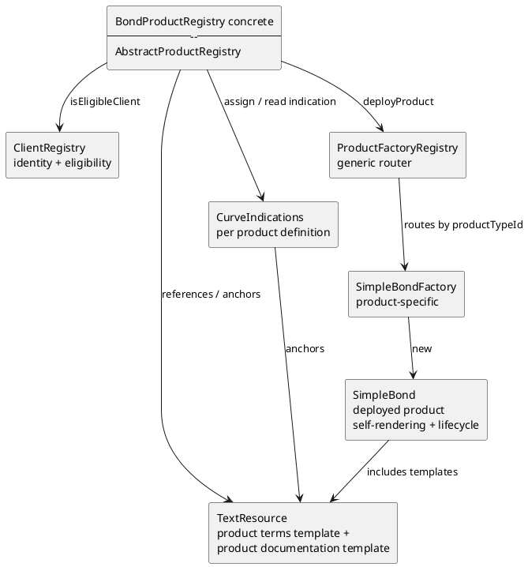

# On-Chain Tokenized Product Framework

A modular Solidity framework for issuing, referencing, and trading tokenized
financial products (e.g. bonds) with **self-rendering products backed by
on-chain product terms templates**.

Product terms templates (XML) and product documentation templates (XSLT) are
stored immutably on-chain and referenced by reusable *product definitions*.
Clients request trades against a product definition;
each trade deploys a concrete *product* instance that resolves its own live
state into a renderable document via an ERC-8100 / `evmstate` binding profile.

---

## Table of Contents

- [Design Principles](#design-principles)
- [Architecture Overview](#architecture-overview)
- [Modules](#modules)
    - [1. Text Resources](#1-text-resources)
    - [2. Client Registry](#2-client-registry)
    - [3. Product Registry](#3-product-registry)
    - [4. Product Indications](#4-product-indications)
    - [5. Product Factories](#5-product-factories)
    - [6. Products](#6-products)
- [End-to-End Flow](#end-to-end-flow)
- [Key Conventions](#key-conventions)
- [Deployment Order](#deployment-order)
- [Dependencies](#dependencies)
- [Status](#status)

---

## Design Principles

- **Separation of structure and state.** Product terms templates and product
  documentation templates are stored once as immutable text; concrete products
  resolve the dynamic `evmstate:call` bindings at render time. Nothing large is
  duplicated per trade.
- **Reusability via product definitions.** A *product definition* is a published
  product terms template + product documentation template + product type under
  which many products are deployed.
- **Integrity by construction.** Content is anchored by `keccak256`, verified
  on-chain at finalization, and reproducible off-chain.
- **Cohesive registry abstraction.** `AbstractProductRegistry` contains the
  complete product-agnostic registry workflow; concrete registries supply only
  product-family resource and indication acceptance rules.
- **Consistent ownership.** All long-lived, owner-managed contracts use
  OpenZeppelin `Ownable2Step`.

---

## Architecture Overview

---

## Modules

### 1. Text Resources

Immutable on-chain storage for large text, including product terms templates
and product documentation templates, stored as SSTORE2-chunked bytecode.

| Contract | Role                                                 |
|---|------------------------------------------------------|
| `ITextResource` | Read/lifecycle interface (ERC-165), including the canonical finalized-content Web3 URL. |
| `TextResource` | Chunked storage, hash verification, reconstruction. One-shot **or** staged publishing. |

- **One-shot:** full content in the constructor (small resources, ≤ EIP-3860
  init-code limit).
- **Staged:** `appendChunk` across transactions, then
  `finalize` (large resources).
- **Integrity:** `contentHash() == keccak256(content())`, verified on-chain at
  finalization and reproducible off-chain
  (`keccak256(fetchedBytes) === contentHash()`).
- **Canonical URL:** after finalization, `web3Url()` returns
  `web3://<resource-address>:<chain-id>/content`.
- Chunk size bounded by `MAX_CHUNK_SIZE = 20_000` (< SSTORE2's 24 KB limit).
- Uses `mcopy` (EIP-5656) — **requires Cancun EVM**.

### 2. Client Registry

Source of truth for client identity, lifecycle, and eligibility.

| Contract | Role |
|---|---|
| `IClientRegistry` | Interface. |
| `ClientRegistry` | Deployable (`Ownable2Step`). |

- Lifecycle: `Unknown → Active → {Suspended, Revoked}`; `Revoked` is terminal.
- **Registered** = known to the system (`status != Unknown`).
- **Eligible** = `Active` + derived per-product-definition rules (Option B / derived model;
  `productDefinitionId` reserved for future per-product-definition criteria).

### 3. Product Registry

A *product definition* anchors a reusable product terms template and product
documentation template and manages their lifecycle. One product-agnostic
abstract registry coordinates definitions, indications, client eligibility,
trade requests, and product deployment; the concrete registry supplies only
product-family acceptance rules.

| Contract | Role |
|---|---|
| `AbstractProductRegistry` | Product-definition publication, lifecycle, ERC-8100 rendering, resource validation, indication assignment, eligibility-gated trade requests, deployment, and trade-to-product lookup. |
| `BondProductRegistry` | Concrete bond resource and indication acceptance rules. |

- `productDefinitionId = keccak256(abi.encode(name, address(this)))` (name is the
  unique key; no duplicates, no renaming).
- `partId = uint256(productDefinitionId)` (ERC-8100 rendering).
- Product definition lifecycle: `Active → {Suspended, Closed} → Archived` (terminal).
- Resources are validated at publish time: must be `ITextResource` (ERC-165),
  finalized, and of an accepted `resourceType` per slot.

### 4. Product Indications

Registries publishing price indications (e.g. yield curves) referenced by product definitions.

| Contract | Role |
|---|---|
| `IProductIndication` | Generic, product-agnostic interface. |
| `AbstractProductIndication` | Indication lifecycle, id/partId, rendering dispatch. |
| `CurveIndications` | Concrete: curve of quotes (`Ownable2Step`). |

- `indicationCategory()` (e.g. `keccak256("CURVE")`) is a coarse tag; the
  product registry maps category → accepted product types (**many-to-many**) via
  `_isAcceptedIndication`.
- One indication per product definition (replaceable, shareable across product definitions).
- Curve quotes have their own sub-lifecycle (`Active`/`Withdrawn`);
  full re-publish overwrites the active board.

### 5. Product Factories

Two-tier factory: a generic router over product-specific builders.

| Contract | Role |
|---|---|
| `IProductFactory` | Generic, registry-facing interface. |
| `IProductSpecificFactory` | Product-specific, generic-facing interface. |
| `ProductFactoryRegistry` | Generic: `productTypeId → specific factory` registry + routing (`Ownable2Step`, `ReentrancyGuard`). |
| `AbstractProductSpecificFactory` | Base: caller guard, schema check, deploy hook. |
| `SimpleBondFactory` | Concrete: builds `SimpleBond`. |

- Call chain (each access-controlled):
  `registry → generic factory → specific factory → product`.
- `productTypeId` is defined by the specific factory (address-independent
  semantic constant), read by product providers when publishing product definitions.
- `productSpecificPayload` is opaque to the generic layer; the specific factory
  validates its schema hash and forwards raw bytes to the product.

### 6. Products

Deployed trade instances that resolve their own state for rendering and run a
generic trade lifecycle.

| Contract | Role |
|---|---|
| `IProduct` | Deployed-state getter surface + `StateUpdated`. |
| `ITradeLifecycle` | ERC-6123-inspired incept/confirm/cancel lifecycle. |
| `AbstractProduct` | Immutable deployment state, lifecycle state machine, XML scaffolding. |
| `SimpleBond` | Concrete demo: negotiable `notional` / `maturity`. |

- **Self-rendering:** the product implements the `evmstate:call` getters the
  product terms template references (e.g. `notional()`, `maturity()`). The
  template is `xi:include`d below
  `ProductResources/ProductTermsTemplate` and resolved against the live product.
- **Trade lifecycle:**
  `Requested → Incepted → Active`, with `Cancelled` (pre-activation, terminal).
- **Terms agreement:** both parties commit to
  `currentTermsHash()` (economic terms bound to the instance and its
  `deploymentStateHash`); terms frozen at inception.
- **Authenticity:** `productSpecificFactory()` (constructor `msg.sender`) +
  `IProductSpecificFactory.isFactoryDeployedProduct(product)` form a
  bidirectional proof.

---

## End-to-End Flow

For a runnable walkthrough, including historical XML views of the product
lifecycle, see
[End-to-End Workflow Demo](smart-product-framework-end-to-end-workflow.md).

1. Publish resources — deploy and finalize `TextResource(productTermsTemplate)` and `TextResource(productDocumentationTemplate)`.
2. Publish product definition — `registry.publishProductDefinition(name, {productTermsTemplate, productDocumentationTemplate, productTypeId})`.
3. Assign indication — registry.assignProductIndication(productDefinitionId, curve, indicationId).
4. Register client — clientRegistry.registerClient({client, lei}).
5. Request trade — registry.createTradeRequest({productDefinitionId, schemaHash, payload}):
   - checks product definition is Active, client is eligible, product type is deployable;
   - deploys the product via the factory chain;
   - records tradeId -> product and anchors deploymentStateHash.
6. (optional) Amend — product.updateTerms(payload) (client, while Requested).
7. Incept — product.inceptTrade(agreedTermsHash) (product provider) -> Incepted.
8. Confirm — product.confirmTrade(agreedTermsHash) (client) -> Active.
9. Render — the renderer calls `product.stateXmlTemplate()`, resolves the
   `evmstate` bindings, and the frontend applies the product documentation template.

---

## Key Conventions

### Identifier & hash schemes

| Value | Definition                                                                                                                                                                                                                                                |
|---|-----------------------------------------------------------------------------------------------------------------------------------------------------------------------------------------------------------------------------------------------------------|
| `TextResource.contentHash` | `keccak256(content)`                                                                                                                                                                                                                                      |
| `productDefinitionId` | `keccak256(abi.encode(name, address(registry)))`                                                                                                                                                                                                          |
| `partId` (productDefinition) | `uint256(productDefinitionId)`                                                                                                                                                                                                                            |
| `indicationId` | implementation-defined; obtain `partId` via `partIdForIndication` (do **not** assume `uint256(id)`)                                                                                                                                                       |
| `productTypeId` | address-independent semantic constant (e.g. `keccak256("SIMPLE_BOND")`)                                                                                                                                                                                   |
| `tradeId` | `keccak256(abi.encode(registry, chainId, nonce, client, productDefinitionId))`                                                                                                                                                                          |
| `deploymentStateHash` | `keccak256(abi.encode(registry, chainId, tradeId, product provider, client, productDefinitionId, productDefinitionVersion, productTypeId, productTermsTemplate, productTermsTemplateContentHash, productDocumentationTemplate, productDocumentationTemplateContentHash, schemaHash, keccak256(payload)))` |
| `currentTermsHash` | `keccak256(abi.encode(product, deploymentStateHash, economicTermsHash))`                                                                                                                                                                                  |

### Shared constants

Domain identifiers must be centralized to prevent drift
across the registry, factories, indications, and text-resource classification, e.g. **`BondConstants.sol`**, :

- `SIMPLE_DEMO_BOND_TYPE`, `COMMERCIAL_PAPER_TYPE`
- `CURVE_INDICATION_CATEGORY`
- `BOND_PRODUCT_TERMS_TEMPLATE_RESOURCE_TYPE`
- `BOND_PRODUCT_DOCUMENTATION_TEMPLATE_RESOURCE_TYPE`

> ⚠️ Off-chain deploy scripts must set each `TextResource`'s `resourceType`
> using the same values, and product providers must publish product definitions with a
> `productTypeId` obtained from the deployed factory's `productTypeId()`.

### Rendering (ERC-8100 / evmstate)

- Product definitions and products group their resources under
  `ProductResources`, with separate `ProductTermsTemplate` and
  `ProductDocumentationTemplate` child elements.
- Product definitions expose both templates inside those child elements as
  **inert text** (`parse="text"`);
  bindings remain unresolved.
- Product-definition views always include a `ProductIndicationAssignment`:
  initially `assigned="false"`, then `assigned="true"` with the indication
  contract address, indication ID, and state-part ID. Live indication content
  remains in the separately rendered indication contract.
- Products include both templates inside those child elements as **XML**
  (`parse="xml"`). Bindings in the
  product terms template resolve against the live product getters; the product
  documentation template remains inert as a transformation until the frontend
  applies it to the resolved product state.
- Product-definition and product XIncludes obtain their resource URLs directly
  from `ITextResource.web3Url()`.
- Dynamic collections (e.g. curve quotes) use the array-of-struct profile:
  `evmstate:call="...(tuple(...)[])"`, `evmstate:item-element`,
  `evmstate:item-field`.
- State-part templates may bind a callback's single `uint256` input to the
  renderer context with `evmstate:args="$partId"`. Arbitrary or literal
  arguments remain unsupported.
- Resource integrity is carried inline via `evmstate:integrity="keccak256-0x…"`.

---

## Deployment Order

1. ClientRegistry(owner)
2. BondProductRegistry(owner, clientRegistry)
3. ProductFactoryRegistry(owner, registry)
4. registry.setProductFactory(productFactoryRegistry) # back-ref check
5. SimpleBondFactory(productFactoryRegistry) # generic addr
6. productFactoryRegistry.registerProductFactory(SIMPLE_BOND_TYPE, simpleBondFactory) # ERC-165 + type match
7. Deploy and finalize `TextResource(productTermsTemplate)` and `TextResource(productDocumentationTemplate)`
8. CurveIndications(owner) + publish curve indications
9. registry.publishProductDefinition(...)
10. registry.assignProductIndication(...)
11. clientRegistry.registerClient(...)

---

## Dependencies

| Package | Used for |
|---|---|
| `@openzeppelin/contracts` | `Ownable2Step`, `Strings`, `IERC165`, `ReentrancyGuard` |
| `solady` | `SSTORE2` (chunked resource storage) |

- **Solidity:** `^0.8.24`
- **EVM version:** **Cancun** (required for `mcopy` in resource/product XML paths)

---

## Status

> ⚠️ **Prototype / demo.** Not audited. `SimpleBondDemo` is a minimal example;
> real products will extend the trade lifecycle with product-specific phases
> (issuance, coupons, redemption) on top of `Active` via the `_onActivated`
> hook.
